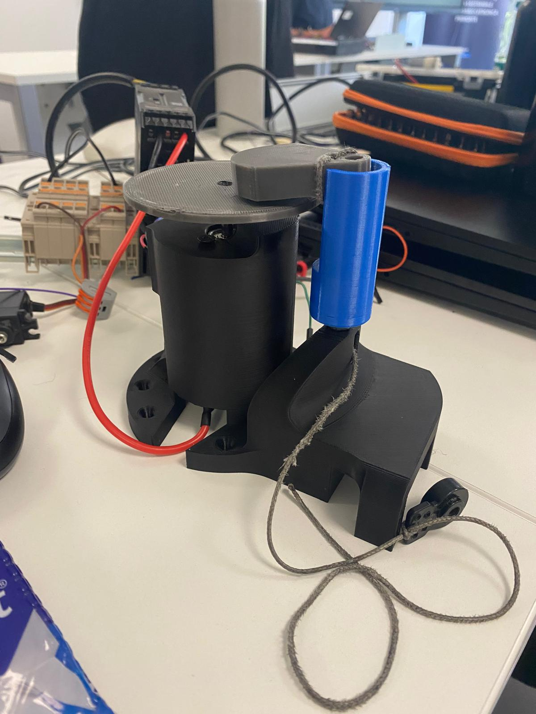
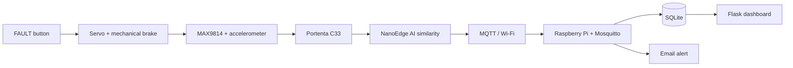
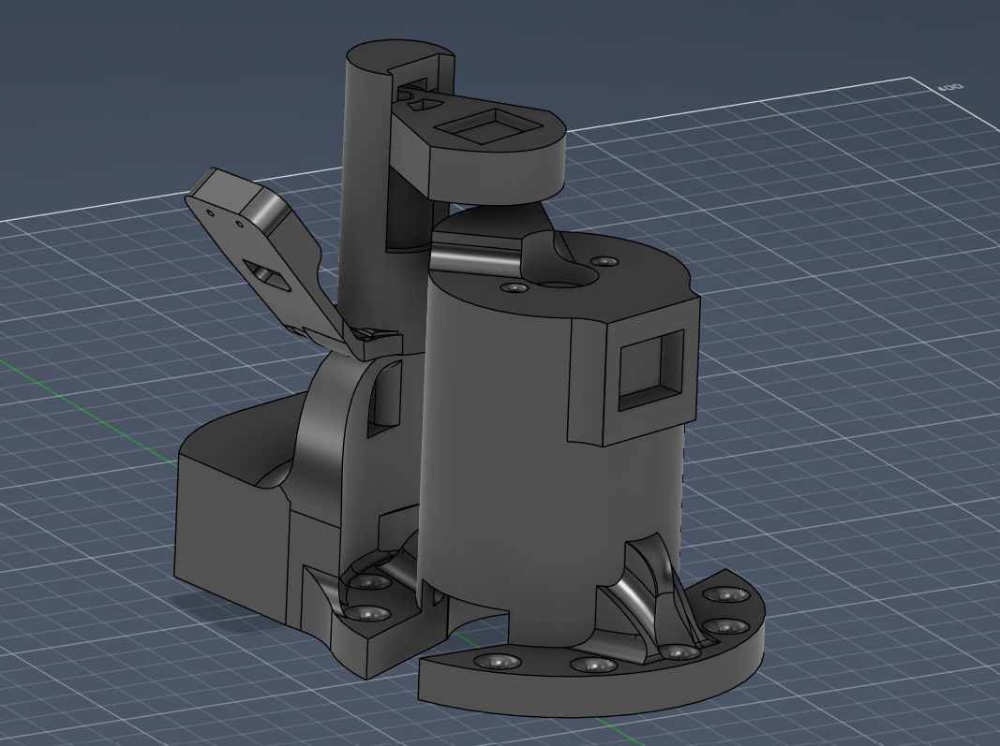

# Edge AI Motor Anomaly Detection Test Bench

**ITS team project** combining embedded sensing, Edge AI, MQTT, Raspberry Pi, SQLite and a Flask dashboard to monitor a brushed DC motor and detect abnormal behaviour.

> This is a curated portfolio repository. Recovered project artifacts and later reconstructions are explicitly separated so the repository does not overclaim authorship or completeness.



## System overview



The idea is simple: learn how the motor behaves normally, create a controlled mechanical disturbance with the servo, observe the change through microphone/vibration sensors and report an anomaly only when the sensor/Edge-AI path indicates that the behaviour is different.

## What is actually in this repository

```text
.
├── assets/                    # Prototype/CAD images
├── cad/                       # STEP mechanical assembly
├── hardware/                  # Electrical/wiring schematics
├── firmware/
│   ├── recovered/             # Recovered integrated Portenta firmware, sanitized
│   ├── data_collection/       # LIS2DW12 + MAX9814 acquisition sketches
│   └── reconstructed/         # Later corrected-flow reconstruction (clearly labeled)
├── raspberry/                 # Reconstructed Python/Flask/SQLite/MQTT side
├── docs/                      # Architecture, status
├── third_party/               # NanoEdge AI redistribution note
└── CREDITS.md                 # Team attribution
```

## Embedded side

The most valuable recovered code is `firmware/recovered/banco_prova_brushed_recovered.ino`. It contains:

- Portenta C33 setup;
- MAX9814 microphone acquisition;
- LIS2DW12 XYZ acquisition over I2C;
- NanoEdge AI learning/detection API calls;
- servo and button management;
- Wi-Fi/MQTT publishing.

The standalone collectors show the frame formats used for Edge AI data acquisition: 256 microphone samples at 8 kHz and 256 XYZ accelerometer samples at 800 Hz.

## Raspberry side

`raspberry/` implements the documented architecture:

- Mosquitto broker;
- Python subscriber on `banco/#`;
- SQLite persistence;
- anomaly email handling;
- Flask dashboard with `/api/live`.

**Important:** these Raspberry source files were reconstructed from project documentation/chat history and are not claimed to be a byte-for-byte recovery of the original Pi filesystem.

## MQTT topics

| Topic | Purpose |
|---|---|
| `banco/motore_brushed/dati` | Live motor data |
| `banco/motore_brushed/anomalia` | Detected anomaly event |
| `banco/stato` | Bench state |

Example payload:

```json
{
  "macchina": "motore_brushed",
  "similarity": 85,
  "microfono": 1234,
  "vibrazione": 567,
  "mic_peak": 100,
  "vib_peak": 50,
  "rpm": 0,
  "anomalia": false,
  "stato": "RUNNING"
}
```

## The most important engineering lesson

A FAULT button should **inject a physical disturbance**, not directly declare an anomaly. The intended chain is:

`FAULT -> servo/brake -> sensor change -> Edge AI -> low similarity -> MQTT anomaly -> email`

One recovered firmware revision still forces the anomaly before the servo sequence. That historical mismatch is documented rather than hidden.

## Mechanical design

The physical bench includes the motor support, rotating element/brake mechanism and servo housing.



The STEP assembly is in [`cad/test_bench.step`](cad/test_bench.step).

## Project evolution / known mismatch

Early project material and the recovered firmware use a **LIS2DW12** accelerometer. A later technical report refers to **ADXL345/SPI** and states that its real acquisition was still incomplete. Thresholds and FAULT pin assignments also changed during development.

For the exact status, see [`docs/provenance-and-status.md`](docs/provenance-and-status.md).

For GitHub upload: [`docs/github-upload-it.md`](docs/github-upload-it.md).

## Team project

See [`CREDITS.md`](CREDITS.md). This repository does not claim that every part was individually authored by one person.
