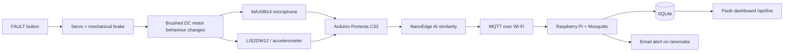

# Architecture

The key conceptual separation is **fault injection vs fault detection**:

- the button/servo creates a physical disturbance;
- the sensors observe what changed;
- Edge AI decides whether the new signal is sufficiently different;
- only a detected anomaly should produce the `/anomalia` event.
